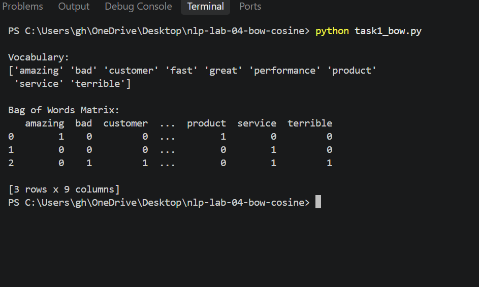
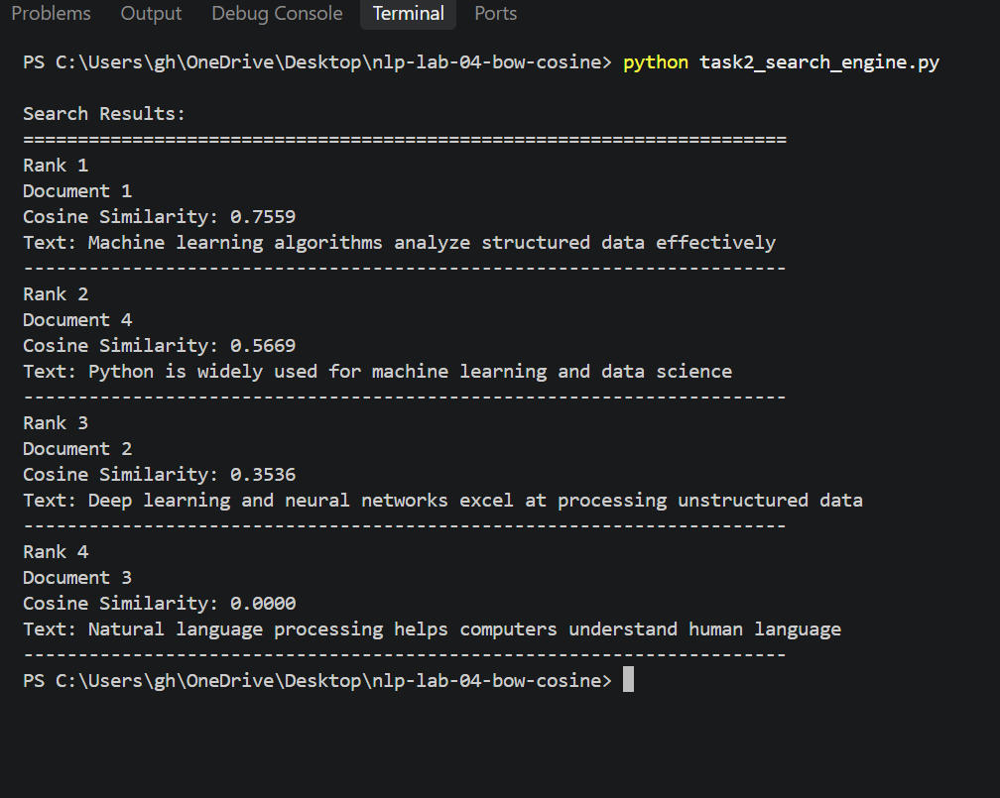

# NLP Lab 04 - Bag of Words and Cosine Similarity

## About This Lab

This repository contains my work for **NLP Lab 04**. In this lab, I worked with the Bag of Words (BoW) technique and Cosine Similarity using Python.

There are two tasks in this lab. The first task focuses on Bag of Words, while the second task uses Cosine Similarity to create a simple mini search engine.

## Files

* `task1_bow.py` - Code for Task 1 (Bag of Words)
* `task2_search_engine_.py` - Code for Task 2 (Mini Search Engine)
* `README.md` - Lab information, outputs, and viva answers

## Task 1 - Bag of Words

In Task 1, I used the Bag of Words approach to convert text into numerical values. The words in the given text are used to create a vocabulary, and the frequency of each word is represented in the output.

### Task 1 Output



## Task 2 - Mini Search Engine

In Task 2, I created a simple search engine using `CountVectorizer` and Cosine Similarity.

The program takes a search query and compares it with the given documents. It then calculates the similarity score for each document and ranks the results from the most similar to the least similar.

### Task 2 Output



## Libraries Used

* Python
* Pandas
* NumPy
* Scikit-learn

## Viva and Reflection Questions

### 1. Word Order Invariance

**Why does "Dog bites man" have the same Bag of Words representation as "Man bites dog"? How does this impact sentiment analysis?**

Bag of Words only looks at the words and how many times they occur. It does not consider the order of the words.

Both sentences contain the same three words: **dog, bites, and man**. Because of this, they get the same Bag of Words representation.

This can be a limitation in sentiment analysis because changing the order of words can change the meaning of a sentence. BoW may not be able to understand the difference properly.

### 2. Sparsity Issue

**What happens to the memory size and density of the BoW matrix when the corpus contains 100,000 unique vocabulary words?**

If there are 100,000 unique words, the BoW matrix can become very large. Most documents will contain only a small number of those words, so most of the values in the matrix will be zero.

This makes the matrix very sparse. A dense matrix can use a lot of memory in this situation, so sparse matrix representations are useful because they store the non-zero values more efficiently.

### 3. Zero Similarity

**Why does Document 3 in Task 2 receive a Cosine Similarity score of 0.0000 for the query "machine learning algorithms for data"?**

Document 3 is:

> Natural language processing helps computers understand human language

The query contains words such as **machine, learning, algorithms, and data**. Document 3 does not have any of these important words in common with the query after stop words are removed.

Because there are no common terms between the query and Document 3, their vectors do not overlap. Therefore, the Cosine Similarity score is **0.0000**.

## How to Run the Code

First, make sure Python and the required libraries are installed.

For Task 1:

```bash
python task1_bow.py
```

For Task 2:

```bash
python task2_search_engine_.py
```

## Conclusion

Through this lab, I learned how Bag of Words can be used to represent text numerically and how Cosine Similarity can be used to compare documents with a search query. The second task also helped me understand the basic idea behind ranking search results based on text similarity.

## Author

**Laiba Rafique**
